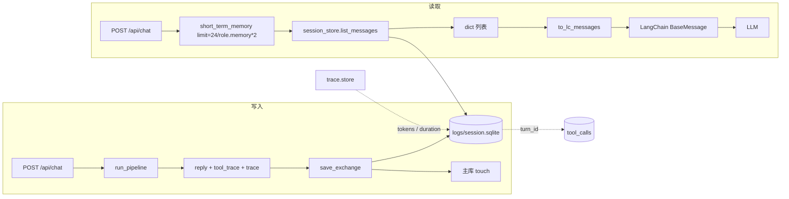

# 机制详解（工作区 / 短期记忆 / 技能 / 群组）

> 本文由 `工作区模型.md`、`短期记忆.md`、`技能系统.md`、`群组模式.md` 合并而成。
> 章节号沿用原文，引用写法：`§短期记忆 6`＝「短期记忆」部分第 6 节；`§工作区模型` 无编号，直接用节名。
> 图的节点与工具矩阵见 [`Agent与功能.md`](./Agent与功能.md)；开关与权限口径见 [`运维手册.md`](./运维手册.md) §配置总表。

## 工作区模型

本应用存在**两层工作区**，二者容易混淆，特立此文档避免踩坑。

### 两层结构

- **主工作区（main workspace）**：用户在设置页配置的空间；通过 `PUT /api/workspace` 设置，
  或由环境变量 `CHATVEIN_WORKSPACE` 指定，否则落到 `CHATVEIN_DATA_DIR/workspace`。
  由 `backend/mcps/workspace.py` 的 `workspace_root()` 解析。

  主工作区是**配置项 / 容器**，不是 Agent 实际读写文件的沙箱。

- **会话工作区（conversation workspace）**：在主工作区之下，为每个会话分配的
  `YYYYMMDD-HHMMSS-xxxxx` 目录（`backend/mcps/sandbox.py: allocate_workspace_name`）。
  由 `conversation_root()` + `init_conversation_layout()` 解析成带 `output/ logs/ runs/`
  布局的目录。**这才是 Agent 真正运行、读写文件的「真正工作区」。**

路径关系：

```text
<主工作区>                                  (workspace_root)
  └─ <YYYYMMDD-HHMMSS-xxxxx>/               (会话工作区 = current_sandbox，真正的沙箱)
       output/                              # 产物：用户需要的文件
       logs/
         session.sqlite                     # 本会话：消息(短期记忆) / 工具返回 / meta
       runs/
         .venv/                             # 代码沙箱虚拟环境
         *.py                               # 沙箱脚本
       uploads/                             # 输入框拖入/选择的本机文件落盘处
       ocr_input/                           # OCR 把图片落到的位置
```

### 关键规则（务必遵守，避免出错）

1. **Agent 在会话沙箱内运行**。`POST /api/chat` 以
   `use_conversation_sandbox(workspace_dir)` 包裹整轮，之后 `current_sandbox()` 与
   `resolve_in_sandbox()` 都相对**会话目录**，而非主工作区。文件系统工具（`mcp-fs` 的
   `write_file` / `list_directory` 等）与 bash / 代码沙箱一样，只认会话根。
   路径入参：会话内可用相对或绝对路径；**会话外必须传绝对路径**，并走与 Bash
   相同的人机确认弹窗，允许后才执行。

2. **任何需要被 Agent 读取的文件，必须落在所属会话工作区内，不要落在主工作区根目录。**
   - 例：`ocr_image(source)` 解析本地路径时，先 `resolve_in_sandbox`（会话目录），
     失败才 `resolve_in_workspace`（主工作区）兜底。若文件只在主工作区根，会多一次拷贝，
     且新会话的沙箱根本找不到它 —— 这正是「找不到图片」类报错的来源。

3. **上传接口 `POST /api/uploads` 必须带 `conversation_id`。**
   后端 `_resolve_upload_root()` 据此把文件写入对应会话工作区的 `uploads/`，并返回
   **相对会话根**的路径（如 `uploads/微信图片_xxxx_ab12cd.jpg`）。
   缺 `conversation_id` 时回退到主工作区（兜底），但不符合预期，形同 bug。

4. **前端已逐级透传当前会话 id**：`ChatView(activeId) → ChatPanel(conversationId) →
   Composer`，`uploadFiles(files, conversationId)` 会把它发到后端。改动上传链路时
   不要丢失这层传递；新增「拖拽/选择文件」入口也要带上 `conversationId`。

### 代码落点

| 文件 | 关键符号 | 职责 |
| --- | --- | --- |
| `backend/mcps/workspace.py` | `workspace_root()` `resolve_in_workspace()` | 主工作区解析与越界校验 |
| `backend/mcps/tools/fs.py` | `_resolve` → `current_sandbox` / `resolve_in_sandbox` | Agent 文件工具只认会话根 |
| `backend/conversations/service.py` | `workspace_root_for(workspace_dir)` | 把会话 `workspace_dir` 解析成带布局的会话根 |
| `backend/main.py` | `/api/uploads` → `_resolve_upload_root()` `_handle_upload_item()` | 上传落盘到会话工作区（或回退主工作区） |
| `src/api/db.ts` | `uploadFiles(files, conversationId?)` | 前端上传入口，透传会话 id |
| `src/components/views/ChatView.tsx` `src/components/chat/ChatPanel.tsx` `src/components/chat/Composer.tsx` | `conversationId` 透传 | 把当前会话 id 送到上传调用 |

### 一句话总结

> 配置的是**主工作区**；在主工作区里按日期生成的 `YYYYMMDD-HHMMSS-xxxxx` 会话文件夹，
> 才是 Agent 真正干活的**工作区**。凡是给 Agent 用的文件（上传图片、附件等），
> 都放进这个会话文件夹，而不要放进主工作区根。


---

## 短期记忆

> 短期记忆（short-term memory）负责把「一个会话内最近若干轮对话」读出来，作为上下文回灌给本轮 Agent 执行。本文档梳理它在 chatvein 中的存储、读写、窗口策略与接线路径。

---

### 1. 设计原则

- **消息只在会话空间库**：主库（`conversations` 表）只存会话元数据（`id / title / workspace_dir / created_at / updated_at / skills`），具体消息、工具轨迹、推理字段全部落在会话工作区的 `logs/session.sqlite`。这样：
  - 会话级数据跟随 workspace 走，可随 workspace 归档 / 删除；
  - 主库始终轻量，会话列表 / 预览查询不必扫描消息表。
- **短期记忆 = 最近 N 条落库消息**：不做跨会话检索、不做向量召回——严格限定在"同一 `workspace_dir` 下最近 N 条"；`short_term_memory` 本身只读取，不改写。
- **读取窗口以「条数」为单位**：`limit` 指消息行数（user + assistant 混合计数），读取阶段不按 token 预算。
- **送入模型前再按 token 预算装配**（`backend/agents/context.py::assemble_context`）：历史能装下就原样送入；超预算才把较早对话压成摘要并保留最近若干轮原文，避免按条数硬截断丢掉关键事实。
- **不回放 tool 消息**：`tool_calls` 是审计信息，只写不落回模型上下文，避免脏 `tool_call_id`。

---

### 2. 存储层：`logs/session.sqlite`

**位置**：`<workspace_root>/logs/session.sqlite`，`workspace_root = conversation_root(workspace_dir)`。每个会话独立一个 SQLite 文件。

**Schema**（`schema_version = 1`）：

```sql
-- 消息表：短期记忆的核心数据源
CREATE TABLE IF NOT EXISTS messages (
    id INTEGER PRIMARY KEY AUTOINCREMENT,
    role TEXT NOT NULL CHECK (role IN ('user', 'assistant', 'system', 'tool')),
    content TEXT NOT NULL,
    route TEXT,                              -- simple/medium/hard
    used_llm INTEGER NOT NULL DEFAULT 0,
    turn_id TEXT,                            -- 本轮 user+assistant 共享
    route_reason TEXT,                       -- 路由理由（understand 输出）
    tool_plan TEXT,                          -- medium/hard 的 tool_plan
    tokens INTEGER NOT NULL DEFAULT 0,
    duration_ms INTEGER NOT NULL DEFAULT 0,
    created_at TEXT NOT NULL
);
CREATE INDEX IF NOT EXISTS idx_messages_id ON messages(id);

-- 工具轨迹：独立表，用 turn_id 关联本轮 assistant 消息
CREATE TABLE IF NOT EXISTS tool_calls (
    id INTEGER PRIMARY KEY AUTOINCREMENT,
    turn_id TEXT,
    tool_name TEXT NOT NULL,
    tool_call_id TEXT,
    arguments_json TEXT,
    result_text TEXT,                        -- 超过 50_000 字截断
    status TEXT NOT NULL DEFAULT 'ok',
    created_at TEXT NOT NULL
);
CREATE INDEX IF NOT EXISTS idx_tool_calls_turn ON tool_calls(turn_id);

-- 元数据：schema 版本等
CREATE TABLE IF NOT EXISTS meta (key TEXT PRIMARY KEY, value TEXT NOT NULL);
```

**演进策略**：`ensure_session_db()` 在每次打开时幂等执行 DDL；对新增列走 `ALTER TABLE ... ADD COLUMN` 捕获 `duplicate column`；`tool_calls.turn_id` 若发现类型不对则整表 drop+rebuild。

代码索引：[session_store.py](file:///e:/project/chatvein/backend/conversations/session_store.py#L15-L91)

---

### 3. 读取路径

#### 3.1 UI 历史：`ConversationsService.list_messages(conversation_id)`

- 通过 `_session_db_for(conversation_id)` 定位该会话的 `logs/session.sqlite`。
- 调 `session_store.list_messages(db, limit=500)`：先 `ORDER BY id DESC LIMIT ?` 取最近 N 条，再 `reversed` 还原为时间正序。
- **tokens / duration 事后补齐**：如果 assistant 消息的 `tokens=0` 或 `duration_ms=0`，用 `_trace_metrics_by_turn(db)` 从 `trace.store.list_turn_traces` 拿本轮总 tokens 和 elapsed，再 `session_store.apply_turn_metrics` 只回填 0 值字段（避免覆盖已落盘的更精确值）。

代码索引：[service.py: list_messages](file:///e:/project/chatvein/backend/conversations/service.py#L126-L152)、[session_store.py: apply_turn_metrics](file:///e:/project/chatvein/backend/conversations/session_store.py#L236-L252)

#### 3.2 短期记忆：`ConversationsService.short_term_memory(workspace_dir, *, conversation_id, limit)`

给 Agent 用。签名看起来带 `conversation_id`，但实现忽略它——`workspace_dir` 是唯一入口，因为一个 workspace 就对应一个会话空间库。

```python
def short_term_memory(self, workspace_dir, *, conversation_id=None, limit=24):
    _ = conversation_id
    db = session_db_path(self.workspace_root_for(workspace_dir))
    return session_store.list_messages(db, limit=limit)
```

返回值是一批 dict，字段包括 `id / role / content / route / used_llm / turn_id / tokens / duration_ms / created_at`——注意比最终喂给 LLM 的消息更多元信息，方便日志与调试，不影响 `to_lc_messages` 的选取。

代码索引：[service.py: short_term_memory](file:///e:/project/chatvein/backend/conversations/service.py#L279-L289)

---

### 4. 写入路径

#### 4.1 主链：`ConversationsService.save_exchange(...)`

被 `/api/chat` 命中。做三件事：

1. **主库 touch**：`_repo.touch_exchange(cid, title_hint=...)` 更新会话 `updated_at` 与首次 title。
2. **会话库写入 user + assistant**：`session_store.append_message(db, "user", user_text, route=...)` 和 `session_store.append_message(db, "assistant", reply_text, route=..., used_llm=..., turn_id=..., route_reason=..., tool_plan=..., tokens=..., duration_ms=...)`。**`turn_id` 由调用方传入或生成一次**（`uuid.uuid4().hex`），user / assistant / tool_calls 共享。
3. **写入 tool_trace**：每条 `tool_calls.append` 一次，同样挂 `turn_id`。

返回 `(conversation_id, user_message_record, assistant_message_record)` 给上层组装 HTTP 响应。

代码索引：[service.py: save_exchange](file:///e:/project/chatvein/backend/conversations/service.py#L193-L265)

#### 4.2 遗留链：`record_turn(...)`

按 `workspace_dir` 写入（不落主库），早期 pipeline 直接调用，现在仍以兼容路径保留。写入内容与 `save_exchange` 中的会话库部分完全一致，但不做主库 touch。

代码索引：[service.py: record_turn](file:///e:/project/chatvein/backend/conversations/service.py#L291-L332)

#### 4.3 撤回 / 停止：`delete_last_exchange`

会话级撤回最近一轮（user + assistant + 该轮 tool_calls）。带双防护避免误删：

- `user_content` 若传入，须与最近一条 user 消息的 `strip()` 结果相等；
- `after_message_id` 若传入，须小于最近 user 消息的 `id`（相当于"baseline"锚点，防止并发新消息插入后误删）。

任一校验不通过返回 `0`，不做删除。删消息后同步 `DELETE FROM tool_calls WHERE turn_id = ?`。

代码索引：[session_store.py: delete_last_exchange](file:///e:/project/chatvein/backend/conversations/session_store.py#L153-L191)、[service.py: delete_last_exchange](file:///e:/project/chatvein/backend/conversations/service.py#L154-L181)

---

### 5. 送入 Agent：`to_lc_messages`

`backend/agents/context.py::assemble_context` 是送模型的统一入口（按 token 预算装配、超预算压缩较早历史）；`backend/agents/memory.py::to_lc_messages` 作为底层转换与降级路径保留——关闭压缩（`CHATVEIN_CTX_COMPACT=0`）或装配异常时，仍按最近 24 条截断，与旧行为一致。

```python
DEFAULT_HISTORY_LIMIT = 24

def to_lc_messages(history, *, limit=DEFAULT_HISTORY_LIMIT) -> list[BaseMessage]:
    if not history:
        return []
    rows = history[-max(1, limit):]
    out: list[BaseMessage] = []
    for row in rows:
        role = str(row.get("role") or "")
        content = str(row.get("content") or "").strip()
        if not content:
            continue
        if role == "user":
            out.append(HumanMessage(content=content))
        elif role == "assistant":
            out.append(AIMessage(content=content))
        elif role == "system":
            out.append(SystemMessage(content=content))
        # tool 角色不直接回灌，避免无绑定 tool_call_id 的脏消息
    return out
```

关键行为：

- 按 `limit` 从**尾部**截取（`history[-max(1, limit):]`），即"最近 N 条"；
- 空 `content` 跳过（撤回 / 停止留空的占位不会污染上下文）；
- `tool` 角色一律跳过——工具结果通过 `tool_trace` 结构化记录，不参与上下文回灌；
- **不做去重、不做轮次配对**：如果最近 N 条刚好以 user 结尾或 assistant 开头，就原样返回。当前 `limit` 都是偶数或允许不配对。

代码索引：[memory.py](file:///e:/project/chatvein/backend/agents/memory.py)

---

### 6. 窗口策略

**默认 24 条**（`DEFAULT_HISTORY_LIMIT = 24`），来自 main.py：

```python
memory_limit = 24
if role_runtime and role_runtime.get("memory") is not None:
    try:
        memory_limit = max(0, min(60, int(role_runtime["memory"]) * 2))
    except (TypeError, ValueError):
        memory_limit = 24
```

- 角色 `memory` 字段是"轮次数"，乘 2 转成消息条数（每轮 = 1 user + 1 assistant）；
- 硬 clamp 到 `[0, 60]`：0 表示完全无上下文，60 是硬上限（约 30 轮）；
- 类型异常回退到 24；
- **token 预算优先于条数**：`assemble_context` 按模型 `context_window_k` / `max_tokens` 推导历史预算（`CHATVEIN_CTX_WINDOW` / `CHATVEIN_CTX_OUTPUT_RESERVE` 可覆盖）；最近 `CHATVEIN_CTX_RECENT_TURNS`（默认 6）轮保留原文，更早的压成摘要；
- 摘要写回会话库 `context_summaries`（按 `first_message_id + last_message_id` 唯一），同区间复用，不重复付费。

代码索引：[main.py](file:///e:/project/chatvein/backend/main.py#L175-L185)

---

### 7. 与 LangGraph 流水线的接线

调用链（自上而下）：

```
POST /api/chat
  └─ main.py chat()
       ├─ conversations_service.short_term_memory(workspace_dir, limit=memory_limit)
       │      → list_messages(limit=N)   → 最近 N 条 dict
       ├─ run_pipeline(message, history=history, role=role_runtime)
       │      → run_pipeline(message, history=..., role=...)
       │            → build_pipeline().invoke({"message", "history", "role"})
       │                  ├─ understand: router.understand(text, role=role)   # 只吃本轮，不吃 history
       │                  ├─ simple  → run_simple(text, history=..., ...)    # history → to_lc_messages → LLM
       │                  ├─ medium  → run_medium(text, history=..., ...)
       │                  └─ hard    → run_hard  (text, history=..., ...)
       └─ save_exchange(cid, user_text, reply_text, ...)   # 写回会话库
```

要点：

- `history` 作为 `ChatState.history` 字段一路传递（`_simple_node / _medium_node / _hard_node` 里 `list(state.get("history") or [])`）；
- 各子图的 `run_*` 内部对 `history` 调 `assemble_context`（内部按 token 预算装配，必要时压缩较早历史）再拼本轮 user 句；
- `understand`（意图理解 / 难度判定）**不吃 history**，只做单句改写与路由；这样路由不受历史噪声干扰。

代码索引：[pipeline.py](file:///e:/project/chatvein/backend/agents/graphs/pipeline.py)、[service.py (agents)](file:///e:/project/chatvein/backend/agents/graphs/pipeline.py)

---

### 8. 边界情况

| 场景 | 处理 |
| --- | --- |
| 撤回 / 停止后剩余空占位 | `to_lc_messages` 跳过空 `content` |
| 并发新消息插入后误删 | `delete_last_exchange` 的 `after_message_id` baseline 校验 |
| assistant 消息 `tokens=0` | `list_messages` 用 trace 事后补齐，`apply_turn_metrics` 只补 0 值 |
| 工具结果超大 | `append_tool_call` 硬截断到 50_000 字并追加 `\n…(截断)` |
| 角色未配置模型 | main.py 提前返回 `reply="暂未给角色配置模型"` + 独立 `turn_id`，跳过 Agent 但**仍然 save_exchange**，让撤回 / 历史可查 |
| 首次对话无 history | `short_term_memory` 返回 `[]`，`assemble_context` 返回空 messages，Agent 只带 system prompt |
| 上下文装配异常 / 关闭压缩 | 回退 `to_lc_messages` 的最近 24 条截断，与旧行为一致（`CHATVEIN_CTX_COMPACT=0`） |
| 会话 workspace 缺失 | `_session_db_for` 返回 `None`，`list_messages` / `delete_last_exchange` 短路返回空 / 0 |
| 跨 workspace 混入 | 由 `session_db_path(workspace_root_for(workspace_dir))` 路径约束，天然隔离 |

---

### 9. 关键源码索引

| 位置 | 说明 |
| --- | --- |
| [backend/agents/memory.py](file:///e:/project/chatvein/backend/agents/memory.py) | `to_lc_messages` 与 `DEFAULT_HISTORY_LIMIT` |
| [backend/conversations/session_store.py](file:///e:/project/chatvein/backend/conversations/session_store.py) | SQLite schema、`append_message` / `list_messages` / `delete_last_exchange` / `apply_turn_metrics` / `append_tool_call` |
| [backend/conversations/service.py: short_term_memory](file:///e:/project/chatvein/backend/conversations/service.py#L279-L289) | 对外短记忆读取入口 |
| [backend/conversations/service.py: save_exchange](file:///e:/project/chatvein/backend/conversations/service.py#L193-L265) | 主写入路径 |
| [backend/conversations/service.py: list_messages](file:///e:/project/chatvein/backend/conversations/service.py#L126-L152) | UI 历史读取 + trace 补齐 |
| [backend/agents/graphs/pipeline.py](file:///e:/project/chatvein/backend/agents/graphs/pipeline.py) | `run_pipeline` 转发 |
| [backend/agents/graphs/pipeline.py](file:///e:/project/chatvein/backend/agents/graphs/pipeline.py) | `run_pipeline` / `_simple_node` / `_medium_node` / `_hard_node` |
| [backend/main.py](file:///e:/project/chatvein/backend/main.py#L175-L185) | `memory_limit` 计算 + `short_term_memory` 调用 |

---

### 10. 数据流图




---

## 技能系统

> 图与工具矩阵见 [`Agent与功能.md`](./Agent与功能.md)；与短期记忆 / 群组 / 工作区的交叉点见本文同名章节。

### 1. 方案一句话总结

技能 = **指令文本**，不注册为普通执行工具。注入采用**目录 + 按需加载**：

- system prompt 只注入**技能目录**（`name + description + slug`），不注入正文；
- 模型认为需要时，调用 **`load_skill(slug)` 工具**把对应 `SKILL.md` 完整正文按需拉进上下文；
- 真正的动作仍走已注册的 **MCP 工具**。

```text
技能目录（prompt 文本）  ──→  告诉模型"有哪些技能、何时用"
load_skill(slug) 工具    ──→  按需加载技能正文（几千米 SKILL.md 不挤爆上下文）
MCP 工具（执行能力）     ──→  真正"怎么做"
```

范围限定：`load_skill` 只允许加载**用户已启用**（角色常驻 + 会话级勾选合并）的技能，
不能越权读取未启用技能。这是「prompt 目录 + 按需加载 + 工具兜底」的混合方案。

### 2. 全链路

```text
前端（Composer 附件面板勾选 slug，勾选即会话级持久化）
  → PUT /api/conversations/{id}/skills   # Composer 勾选/移除时即时落盘
  → POST /api/chat { message, conversation_id?, role_id?, skills[] }  # 发送时兜底同步
  → main.py 技能接线：
      常驻技能 role_runtime.resident_skills  +  会话级技能 conversations.skills
      → dict.fromkeys 保序去重（常驻在前、会话在后）
      → skill_prompt_blocks(merged_slugs)
          └─ skills/service.py
              ├─ local_store.load_skill_catalog(slugs)     # 只读已安装技能，生成目录
              └─ local_store.format_skill_catalog_for_prompt()  # name+description+slug
      → 技能目录追加进 role_runtime["prompt"]（有角色时）
      → role_runtime["_skill_slugs"] = merged_slugs        # 下传给下游图
      → run_pipeline → agents/graphs/pipeline.py 组装 system prompt
          └─ prompts.py build_agent_system → "# Role\n{role}" 段
      → medium / hard 图 react_node：
          load_skill 为常驻工具（graphs/common.ALWAYS_ON_TOOLS），无条件挂进工具列表
          （不参与 select_tools 选型，绕开角色工具白名单过滤，保证"勾了技能就一定能按需加载"）
      → create_agent(system_prompt=..., tools=[..., load_skill])
      → agents/llm.py get_chat_model 发出模型请求
      → 模型需要时调用 load_skill(slug)
          └─ mcps/tools/skills.py → local_store.read_skill_md(slug) 返回完整正文
```

### 3. 数据模型与落盘

每个技能一个目录，挂在 `CHATVEIN_DATA_DIR/skills/<slug>/`（默认 `项目根/.chatvein/skills/`）。

```text
<data>/skills/<slug>/
  ├── SKILL.md      # 技能正文（load_skill 按需加载的内容，不直接注入）
  └── meta.json     # 元数据：slug / name / description / version / homepage / installed_at
```

| 项 | 说明 |
| --- | --- |
| 数据根目录 | 优先 `CHATVEIN_DATA_DIR` 环境变量，否则回退 `项目根/.chatvein`（`local_store._data_dir`） |
| slug 校验 | 白名单 `^[a-zA-Z0-9][a-zA-Z0-9._-]{0,127}$`，防止 `../`、绝对路径等越界写入 |
| SKILL.md 上限 | 单文件 120_000 字符（`_MAX_SKILL_MD`），安装超限直接拒绝，加载超限截断 |
| 安装 | `install_skill()`：slug 校验 → 正文校验 → 写 SKILL.md → 写 meta.json |
| 卸载 | `uninstall_skill()`：整目录 `rmtree` |

### 4. 技能来源（两种）

| 来源 | 位置 | 生命周期 | 说明 |
| --- | --- | --- | --- |
| 常驻技能 | `roles.resident_skills`（角色配置） | 每次会话自动带上 | 与人格相关，需稳定在目录里 |
| 会话级技能 | `conversations.skills`（会话配置） | 当前会话持续生效，跨轮保留 | Composer 附件面板手动勾选；已常驻的技能在面板中隐藏，不重复勾选 |

合并规则（`main.py`）：`dict.fromkeys(常驻 + 会话级)` 保序去重，保证 role prompt 里的
技能顺序稳定——**常驻技能在前，会话级技能在后**；重复 slug 只保留第一个。

> 说明：Composer 勾选/移除技能时即时写入 `PUT /api/conversations/{id}/skills`；
> `POST /api/chat` 发送时若携带 `skills` 也会兜底同步（`null` = 不改动，`[]` = 清空会话技能）。
> 发送后 chip 保留在 Composer，供当前会话后续轮次继续生效。

### 5. 注入细节

- **目录生成**：`load_skill_catalog` 只收录已安装技能（未安装 / 重复 slug 静默跳过）；
  `description` 优先取 `meta.json`，缺失时从 `SKILL.md` 头部提取第一个非空段落（`_extract_description`，截 160 字）。
- **目录格式**：`format_skill_catalog_for_prompt` 输出一行一个技能，并在开头明确引导调用 `load_skill`：

```markdown
【已启用技能目录 — 仅当任务确实需要下列技能时，调用 load_skill(slug) 工具加载其完整说明，再按说明执行】
- <技能名> (`<slug>`): <一句话简介>
- <技能名2> (`<slug2>`): <一句话简介>
```

- 有角色：技能目录追加在角色 prompt 之后，模型**先看角色再看技能**。
- 无角色：技能目录直接作为 `role_runtime.prompt`，此时 tools 省略表示不限制工具面。
- `_skill_slugs` 是内部字段，随 `role_runtime` 下传，仅用于标记「本会话已启用技能」；
  `load_skill` 已是常驻工具（`graphs/common.ALWAYS_ON_TOOLS`），由 `medium.py` / `hard.py`
  的 react_node 无条件挂载，与是否启用技能无关。

### 6. `load_skill` 工具

| 项 | 说明 |
| --- | --- |
| 定义 | `mcps/tools/skills.py`，`@tool load_skill(slug: str) -> str` |
| 分组 | 常驻注册到 `mcp-skills` 分组，无需环境探测，`ALL_TOOLS` 恒包含 |
| 返回 | `local_store.read_skill_md(slug)` 的完整正文；超 `_MAX_BODY`(120KB) 截断 |
| 未安装 | 返回明确错误 + 本机已安装技能清单 |
| 离线启发式 | `heuristic()` 返回空列表，不参与离线关键词选工具；离线时由 invoke_tools 提示无法自动填参 |
| 可用性保障 | 常驻工具（`ALWAYS_ON_TOOLS`），react_node 无条件挂载，不参与选型 / 角色白名单过滤 |

### 7. 边界与保护

| 保护项 | 实现 |
| --- | --- |
| 未安装技能 | 目录生成静默跳过；`load_skill` 返回错误 + 可用清单 |
| 越权加载 | `load_skill` 只能读已选技能，但本机技能均为用户安装，无鉴权门槛 |
| 超长正文 | 安装拒绝 / `load_skill` 返回截断 |
| 恶意 slug | 白名单正则校验，防目录穿越 |
| 上下文占用 | 只注入目录（每个技能一行），正文按需进上下文 |

### 8. 现状限制 / 刻意不做

| 限制 | 说明 |
| --- | --- |
| **无全局技能池检索** | `load_skill` 范围限定在用户已选技能内，不从全部已安装技能自动召回 |
| **无 embedding 召回** | 没有根据用户 query 的向量检索层，选技能靠"配置 + 手动勾选 + 模型判断" |
| **无读盘缓存** | 目录生成 / `load_skill` 每次请求重新读磁盘 |
| **无更新检测** | 安装后不检查 SkillHub 是否有新版本 |
| **无技能自动发现** | 不会自动把新安装技能塞进会话，需用户在 Composer 勾选 |

若后续要做"全局技能池"：可新增 `skills/retriever.py`（关键词 / embedding / LLM 选择），
在 `main.py` 技能接线之前用当前消息从**全部已安装技能**召回 top-k 加入目录；
常驻技能建议保留目录注入（人格相关，需稳定可见），懒加载只作用于池子技能。

### 9. 实现文件与代码位置索引

> 技能链路分四层：**路由层 → 服务层 → 落盘层 → Agent 注入层**。
> 下面"关键代码"以函数 / 常量名为准（行号随演进可能漂移），全路径前缀为 `backend/`。

#### 9.1 技能市场 / 安装（`skills/`）

| 文件 | 关键代码 | 职责 |
| --- | --- | --- |
| `skills/__init__.py` | 模块 docstring | 模块入口，文件分工说明 |
| `skills/module.py` | `skills_router` | 路由组装（`/api/skills` 前缀），由 `main.py` include |
| `skills/controller.py` | `get_categories` / `get_skills` / `get_skill_detail` / `post_install` / `delete_skill` | `/api/skills*` HTTP 路由，错误转 HTTPException |
| `skills/service.py` | `list_skills` / `get_skill` / `install_from_hub` / `uninstall_local` / `list_local_skills` / `skill_prompt_blocks` | SkillHub 代理 + **注入接线入口**（生成目录） |
| `skills/local_store.py` | `install_skill` / `uninstall_skill` / `is_installed` / `read_skill_md` / `load_skill_catalog` / `format_skill_catalog_for_prompt` / `load_skill_blocks` / `format_skills_for_prompt` | 落盘（SKILL.md + meta.json）+ 目录生成 + 全文兼容模式 |

#### 9.2 技能来源：会话级 / 角色常驻

| 文件 | 关键代码 | 职责 |
| --- | --- | --- |
| `conversations/controller.py` | `PUT /{conversation_id}/skills` → `update_conversation_skills` | Composer 勾选 / 移除时即时持久化 |
| `conversations/service.py` | `set_conversation_skills` / `get_conversation_skills` | 会话级技能读写 |
| `conversations/repository.py` | `set_skills` / `get_skills` / `_encode_skills` / `_decode_skills` | `conversations.skills` 列 JSON 落库（保序去重） |
| `roles/service.py` | `get_runtime`（返回 `resident_skills`） | 常驻技能来源（每次会话自动带上） |
| `roles/entity/entity.py` | `Role.resident_skills` 字段 | 常驻技能存储列 |

#### 9.3 Agent 注入 / 按需加载

| 文件 | 关键代码 | 职责 |
| --- | --- | --- |
| `main.py` | `chat()` 技能接线段（`merged_slugs` → `skill_prompt_blocks` → 追加 `role_runtime["prompt"]` → 下传 `_skill_slugs`） | **注入核心拼装点** |
| `mcps/tools/skills.py` | `@tool load_skill(slug)` / `TOOLS` / `heuristic()` | 按需拉取 SKILL.md 正文的工具 |
| `mcps/tools/__init__.py` | `build_tool_groups` → `"mcp-skills"` 分组 | 工具分组挂载（恒常驻） |
| `agents/graphs/common.py` | `ALWAYS_ON_TOOLS = ("load_skill", "sandbox_run_python", "get_current_time")` | 聊天常驻工具，绕过选型 / 角色白名单 |
| `agents/graphs/medium.py` / `hard.py` | `react_node`（`names = [*selected, *ALWAYS_ON_TOOLS]`） | 工具列表组装，无条件挂 `load_skill` 等常驻工具 |
| `agents/graphs/pipeline.py` | `_merged_system(role, base)` | simple 分支 system prompt 组装 |
| `agents/graphs/prompts.py` | `build_agent_system(role_prompt=...)` | `# Role` 段置于宪法最前（**最终落地点**） |
| `agents/llm.py` | `get_chat_model` | 按 `role.model_id` 发出模型请求 |

#### 9.4 关键接线代码速查

| 环节 | 位置 |
| --- | --- |
| 注入拼装 | `main.py` `chat()` 技能接线段（约 186-219 行） |
| 目录生成 | `skills/local_store.py` `load_skill_catalog()` + `format_skill_catalog_for_prompt()` |
| 接线入口 | `skills/service.py` `skill_prompt_blocks()` |
| 正文加载 | `mcps/tools/skills.py` `load_skill()` |
| 常驻挂载 | `agents/graphs/common.py` `ALWAYS_ON_TOOLS` |
| 最终落点 | `agents/graphs/prompts.py` `build_agent_system()`（`# Role` 段） |

#### 9.5 API 与前端

| 接口 / 文件 | 说明 |
| --- | --- |
| `POST /api/chat` | `skills[]` 字段兜底同步会话级技能（`null`=不改动 / `[]`=清空 / 列表=覆盖） |
| `PUT /api/conversations/{id}/skills` | Composer 勾选 / 移除时即时持久化 |
| 前端 `Composer.tsx` | 附件面板勾选已安装技能（排除常驻技能，勾选即会话级持久化） |


---

## 群组模式（团队模式与群组注册）

本设计覆盖本轮落地的四块能力：**角色一句话描述**、**会话群组成员注册**、**团队模式**（主 agent 花名册注入 + `delegate_to_agent` 工具 + 按 `actor_id` 隔离的独立短期记忆）、以及 **UI 气泡完整上下文 + 耗时展示**。配套 `Agent与功能.md`（已实现清单）与 `Agent与功能.md`（Agent 图设计）。

> **模块边界**：群组 / 团队功能自 **v12** 起独立成 `backend/chats/` 模块，与 `conversations` 解耦。
> - `conversations`：纯会话管理（CRUD、消息、技能、工作区、短期记忆存储）。
> - `chats`：群组成员花名册（独立表 `chat_groups`）+ 团队装配（主 agent 花名册注入 + ContextVar）。
> - `agents/delegation.py`：`delegate_to_agent` 工具（挂载点仍由 medium/hard 的 react 节点按 `_team_mode` 挂载）。
> 单向依赖：`chats → conversations`（仅查询会话存在性）；`conversations` 不依赖 `chats`。

---

### 1. 角色一句话描述（description）

#### 目标
角色列表 / 群组花名册需要一个一行可读的用途说明，避免只看到名字与模型。

#### 数据流
```
RolesView 表单 → CreateRoleDto/UpdateRoleDto.description
    → roles.repository 整行读写
    → RoleResponseDto.description → rolesStore → 列表副标题
RolesService.get_runtime() 透传 description → 花名册注入（第 3 节）
```

#### 改动点
| 层 | 位置 | 说明 |
| --- | --- | --- |
| 实体 | `roles/entity/entity.py` | `Role` 增加 `description: str = ""`（`max_length=200`） |
| DTO | `roles/entity/dto.py` | `CreateRoleDto` / `UpdateRoleDto` 增加可选 `description`；`RoleResponseDto` 增加必填 `description` |
| Service | `roles/service.py` | `create_role` / `update_role` 写入并 `strip()`；`to_response` / `get_runtime` 透传 |
| 迁移 | `db.py` | `SCHEMA_VERSION` 升到 **10**，`_ensure_roles_description_column()` 补列（旧库） |
| 前端 | `src/api.ts` / `rolesStore.ts` / `RolesView.tsx` | 类型、`makeNewRole`、表单「角色描述」输入框、列表副标题优先显示描述 |

---

### 2. 会话群组成员注册（chats 模块）

#### 目标
会话记录一组参与角色 id（JSON 列表），为团队模式的「花名册」提供持久化来源；支持补注册、随消息透传。

#### 数据模型（v12 起独立表）
`chat_groups` 表（`chats` 模块专属）：

| 列 | 说明 |
| --- | --- |
| `conversation_id` | 主键，外键 `conversations.id ON DELETE CASCADE`（会话删除自动清理） |
| `members` | JSON 文本：角色 id 列表，如 `["r_code_review","r_docs"]` |
| `created_at` / `updated_at` | 时间戳 |

v11 及更早的 `conversations.group_members` 列在 v12 迁移中数据搬入本表后删除，`conversations` 不再感知群组概念。

#### 两种注册路径
1. **补注册**：`POST /api/chats/{id}/group-members`（`GroupMembersDto`）；读取 `GET /api/chats/{id}/group-members`。
2. **随消息透传**：`POST /api/chat` 的 `ChatRequest.group_members` 非空时，`_chat_turn` 在落库前调用 `chats_service.register_group_members` 合并去重。

合并语义：`ChatGroupsRepository.merge_members` 读取现有列表 + 新列表 → 清洗保序去重 → 回写（不覆盖，防前端传错丢历史）。

#### 改动点
| 层 | 位置 | 说明 |
| --- | --- | --- |
| 实体 | `chats/entity/entity.py` | `ChatGroup` 表（`conversation_id` 外键级联） |
| DTO | `chats/entity/dto.py` | `GroupMembersDto`、`ChatGroupRecord` |
| Repository | `chats/repository.py` | `_decode_members` / `_encode_members`；`get_members` / `merge_members` |
| Service | `chats/service.py` | `get_group_members` / `register_group_members`；`assemble_team`（第 3.1 节） |
| Controller | `chats/controller.py` | `GET/POST /api/chats/{id}/group-members`（查询会话存在性 404） |
| 模块 | `chats/module.py` | `chats_router(prefix=/api/chats)` + `chats_service` 单例 |
| 入口 | `main.py` | 挂载 `chats_router`；`ChatRequest.group_members`；`_chat_turn` 随消息注册 |
| 迁移 | `db.py` | `SCHEMA_VERSION` 升到 **12**，`_split_group_members_to_chat_groups()`（搬数据 + 删旧列） |
| 前端 | `src/api.ts` | `registerGroupMembers` / `getGroupMembers` 指向 `/api/chats`；`ConversationRecord` 移除 `group_members`；`sendChat` 透传 |

---

### 3. 团队模式（Team Mode）

#### 触发条件
`POST /api/chat` 携带 `group_members`（非空、且去掉主角色 id 后至少有一个成员）即视为团队模式。主 agent 即当前绑定的角色（协调者），成员为花名册中的其余角色。

#### 3.1 主 agent 花名册注入（chats 模块收口）
`main._chat_turn` 只调用一行 `role_runtime = chats_service.assemble_team(role_runtime, req.group_members, workspace_dir=...)`，内部：
1. 遍历 `req.group_members`，`RolesService().get_runtime(rid)` 取成员（名字 + 一句话描述 + role id），剔除主 agent 自己。
2. 生成花名册文本块，**追加到主 agent 的 role prompt 末尾**：
   - 列出可协作成员；
   - 提示：任务可并行时优先用 `parallel_delegate` 一次派发，有先后依赖才用 `delegate_to_agent`，最后汇总；
   - **提示：任务量小、不需要分工时直接自己完成，不必派发**（小任务短路，见 3.4）。
3. 在 `role_runtime` 上打 `_team_mode: True` + `_roster`，medium/hard 的 react 节点据此挂工具。
4. `set_team_context({workspace_dir, roster})` 写入 ContextVar，供 `delegate_to_agent` 工具读取。

#### 3.2 `delegate_to_agent` 工具
- 位置：`backend/agents/delegation.py`（新文件），`@tool("delegate_to_agent")`，同时导出 `DELEGATE_TOOL` 供挂载。
- 入参：`role_id`（花名册成员）、`task`（子任务）、`instruction`（可选约束）。
- 执行流程：
  1. 读团队上下文；校验 `role_id ∈ roster`（不在花名册直接返回可用成员列表）。
  2. `RolesService().get_runtime(role_id)` 取成员运行时；无模型返回错误。
  3. **独立短期记忆**：`short_term_memory(workspace_dir, actor_id=role_id, limit≈memory×2)` —— 只取该成员名下历史。
  4. 用成员自己的模型 `get_chat_model(role=member_runtime)` + 成员自己的工具 `resolve_tools(member_tools + ALWAYS_ON_TOOLS)` 构建子 agent（`build_react_graph`，medium 量级护栏）。
  5. 跑一轮 ReAct，取 `last_text` 作为成员回复。
  6. `record_turn(actor_id=role_id)` 把「派发任务 + 成员回复」写回成员名下 → 形成成员独立记忆链。
- **任务拆分**：主 agent 可按领域给每个子任务挑选最合适的成员，为每个子任务各调用一次 `delegate_to_agent`（可连续多次、派发给不同成员），最后汇总各成员回复；无依赖的多路子任务走 `parallel_delegate`（见 3.5）。
- **防递归**：子 agent 只挂成员自身工具 + 常驻工具，**不挂** `delegate_to_agent` / `parallel_delegate`。
- 挂载点：`agents/graphs/medium.py` / `hard.py` 的 `react_node`，当 `role._team_mode` 时把 `DELEGATE_TOOL` 追加进工具列表；`parallel_enabled()` 再追加 `PARALLEL_TOOL`（`CHATVEIN_PARALLEL_DELEGATE=0` 时只挂串行）。未开启团队模式时不会挂载，不影响单角色会话。

#### 3.3 按 actor_id 隔离的独立短期记忆
- `session_store.list_messages(db, *, limit, actor_id=None)`：`actor_id` 非空时 `WHERE actor_id = ?`，只取该角色名下消息。
- `conversations.service.short_term_memory(..., actor_id=None)` 透传。
- `conversations.service.record_turn(..., actor_id=None)`：用户/助手两条消息都带 `actor_id` 写入。
- 主 agent 本轮自身的历史仍走全量（`main._chat_turn` 的 `history` 不变），成员各自通过 delegate 时取自己名下记忆 → 互不串线。

#### 3.4 小任务主 agent 直接完成（不派发）
两层约束：
1. **prompt 级**：花名册注入块明确写「任务量小、不需要分工时，直接自己完成即可，不必派发」。
2. **工具级**：`delegate_to_agent` 的 docstring 同样强调「适合分工时派发；小任务直接完成」。工具是可选调用，由主 agent 自行判断，模型默认不会为了用工具而用工具。

#### 3.5 并行 fan-out（批次 2 §2.4）
- 工具：`agents/orchestration.py::parallel_delegate`（`PARALLEL_TOOL`），入参 `tasks: [{role_id, task, instruction}]`，单次 1–8 条。
- 执行：`ThreadPoolExecutor(max_workers=CHATVEIN_DELEGATE_MAX_PARALLEL 默认 4)`，每条任务 `copy_context()` 后调用 `delegation.run_member_task`（与串行共用一条路径，护栏/记忆/步数完全一致）。
- trace 隔离：成员在 `child_span("delegate:<成员名>", parent)` 内执行，`_span_parent` 随 ContextVar 复制 → 各成员 span 子树互不串台；聚合在 `aggregate` span 内。
- 任务板：会话库 `agent_tasks` 表（`running/done/failed/cancelled`），`GET /api/conversations/{id}/agent-tasks?turn_id=` 可查。
- 聚合：成功 ≥2 时用主模型做一次结构化汇总（prompt 要求指出冲突、失败只说「未完成+原因」）；模型不可用或失败则退化为按成员拼接。
- 取消：等待期间每 0.2s 检查取消位，命中即 `future.cancel()` 并抛 `TurnCancelled`；单成员异常按失败隔离，不影响其他成员。
- 开关：`CHATVEIN_PARALLEL_DELEGATE=0` 或并行度=1 → 回退只挂串行 `delegate_to_agent`。

#### 边界与限制
- 主 agent 无模型时团队模式退化：花名册仍注入但主 agent 走离线链路，成员不可被有效派发（成员无模型时工具返回错误说明）。
- 成员角色 `tools` 为空时只挂常驻工具（`ALWAYS_ON_TOOLS`）。
- 嵌套派发（成员再派发给其他成员）不支持：子 agent 不挂 `delegate_to_agent` / `parallel_delegate`。

---

### 4. UI：气泡完整上下文 + 耗时展示

#### 4.1 上下文百分百完整展示
`MarkdownMessage.tsx` 移除 `codeBlockMaxHeight={320}` 上限：长代码块 / 表格不再被压缩出内部滚动条，随气泡整体展开，长内容依赖页面级 `ScrollArea` 滚动查看。

#### 4.2 耗时显示在气泡后面
`ChatPanel.tsx`：把原来的「tokens · 耗时」元信息行从**气泡上方**移到**气泡内容之后**（footer），仍满足：
- 群组变体在行首显示回复者名字（`actor` / `roleName`）；
- 助手消息非流式时展示 `formatTokens(m.tokens)` · `formatDuration(m.durationMs)`；
- 数据源：`ChatMessage.tokens / durationMs`，由 `sendChat` 响应的 `tokens / duration_ms` 就地回填，或 `loadConversation` 从 `turn_traces` 补全（后端 `list_messages` 上限 500 条 + `apply_turn_metrics`）。

---

### 5. 数据库迁移汇总

| 版本 | 变更 | 函数 |
| --- | --- | --- |
| v10 | `roles.description` 列 | `_ensure_roles_description_column()` |
| v11 | `conversations.group_members` 列（JSON 文本，默认 `[]`） | `_ensure_conversations_group_members_column()` |
| v12 | 群组独立成 `chats`：新建 `chat_groups` 表，存量 `conversations.group_members` 数据搬入后删列 | `_split_group_members_to_chat_groups()` |

迁移幂等：`PRAGMA table_info` 探测列是否存在，不存在才 `ALTER TABLE`；`SCHEMA_VERSION` 与 `PRAGMA user_version` 对账，仅在落后时执行。v12 的 `_split` 同样先探测 `group_members` 列，v11 之前的库无该列则跳过。

---

### 6. 端到端时序（群组 @ 成员 → 主 agent 派发）

```
前端群组面板 @成员A,B + 发送
  → POST /api/chat { group_members:[A,B], append_user_message:true, ... }
  → _chat_turn：
      1. open_for_chat 建/取会话
      2. chats_service.register_group_members 随消息透传（合并去重落 chat_groups）
      3. chats_service.assemble_team：roster={A,B 名字/描述} → 注入主 agent prompt + _team_mode + set_team_context
      4. run_pipeline：medium/hard react_node 挂 delegate_to_agent
      5. 主 agent 判断：任务大 → delegate_to_agent(role_id=A, task)
           · 读 ContextVar 团队上下文
           · 取 A 的独立短期记忆（actor_id=A）
           · A 自己的模型+工具跑一轮 ReAct
           · record_turn(actor_id=A) 写回 → A 记忆链
           · 返回 [成员 A 的回复] 给主 agent
      6. 主 agent 汇总 → save_exchange 落主 agent 名下 → 响应 tokens/duration_ms
  → 前端就地回填各成员占位气泡 + 气泡后显示耗时
```

---

> 团队模式在功能清单中的对应项见 [`Agent与功能.md`](./Agent与功能.md) §功能清单 5。
